## API 调用

``` python
1. 你得知道怎么 传入 prompt, 怎么拿到返回值, 怎么做流式输出, 怎么处理错误?
2. 提示词控制, 别把提示词当作文写, 你要学的是让它可控, 比如你要他输出 JSON, 要他只按照某些规则答, 要他遇到不确定就说不知道, 你能把输出控制住,
后面做 Agent 才不会崩
```

## LangChain 家族四大支柱

``` python
四大支柱: LangChain, LangGraph, Deep Agent, LangSmith
官方文档: https://docs.LangChain.com/oss/python/concepts/products
LangChain: 智能体开发的基石
LangChain 为开发者提供了模型调用, 工具与中间件集成, 智能体构建等一整套基础能力
统一的模型抽象层: 屏蔽了不同模型服务提供商 (如 OpenAI, Anthropic, Ollama 等) 的接口差异, 提供了一致的调用方式
高度模块化的设计: 使用 Message, Tool, Agent, Middleware 等组件实现灵活的组合与扩展
丰富的集成生态: 预置了丰富的数据源, API, 中间件等, 构成了强大的 AI 能力枢纽
在整体架构中, LangChain 如同智能体的操作系统内核, 是所有上层能力构建的基础
结论: 如果你需要构建简单的智能体应用, 无序复杂的编排需求, 那就选 LangChain
```

## LangGraph 复杂工作流的编排引擎

``` python
当智能体的任务从单一指令执行扩展为多步骤, 有状态的复杂工作流时, LangGraph 应运而生
其核心思想是 将智能体内部抽象为一张有向图
节点(Node): 代表独立的功能单元或决策点
边(Edge): 定义了节点之间的流转条件与路径
状态(State): 作为一个共享上下文, 在节点间传递并持久化存储任务信息
```

### LangChain = 能力抽象层 (LLM/Tool/Message 标准化), 负责 有什么能力

### LangGraph = 执行与编排层 (状态机/工作流/多Agent系统), 负责 怎么跑

## Deep Agent: 智能体的执行框架

``` python
Deep Agent 是新推出的全新组件, 被定位为 Agent Harness(智能体执行框架). 它构建于 LangChain 与 LangGraph 之上, 增加了规划能力,
文件系统, 子 Agent 等高级功能, 旨在让开发者无需从零构建复杂的控制逻辑, 即可创建具备深度规划, 长期记忆的多专家协作能力的智能体
Deep Agent 的核心能力如下:
显式规划: 自主生成, 执行并动态调整多步任务计划
虚拟文件系统: 为智能体提供结构化的中间结果与智能存储
子智能体: 支持任务在多个智能体之间的分解和协作
```

## LangChain/LangGraph/Deep Agent 三者关系

``` python
三个框架不是竞争关系, 并非互斥, 复杂项目完全可以同时用到这三层
LangChain 是解决 快的问题, 快速构建
LangGraph 是解决 稳的问题, 稳定运行
Deep Agent 是解决 复杂的问题
```

## LangSmith 可视化监控与测试平台

``` python
当智能体系统逐渐复杂时, 单靠日志与打印输出 (print) 调试已无法满足调试与指令管理的需求
LangSmith 是 LangChain 官方推出的 可视化监控与测试平台, 用于跟踪, 记录和分析智能体在运行过程中的完整调用链路, 让智能体的内部运行
过程变得透明和可评估
LangSmith 的核心目标:
全链路追踪: 可视化追踪模型调用, 提示词输入, 结果输出, 工具使用等行为
调试与优化: 发现运行中智能体的异常行为与性能瓶颈
评测与质量控制: 支持人工与自动化评测, 量化智能体表现
团队协作: 支持多人共享测试集与调用记录
```

## 大模型应用场景介绍

``` python
1. RAG 开发
背景:
大模型的知识冻结: 随着 LLM 规模扩大, 训练成本与周期相应增加, 模型 无法实时学习 到最新的信息或动态变化. 导致 LLM 难以应对诸如 '请推荐现在的
热门影片' 等时间敏感的问题
大模型幻觉: 设计到大模型从未在训练过程中学习过的信息时, 大模型无法给出准确的答复, 转而开始臆想和编造答案
2. 举例
LLM 在考试的时候面对陌生的领域, 答复能力有限, 然后就准备放飞自我了, 而此时 RAG 给了一些提示和思路, 让 LLM 懂了开始往这个提示的方向做, 最终
考试的正确率从 60% 到 90%!
3. 何为 RAG (Retrieval-Augmented Generation (检索增强生成))
阶段一: 资料入库与向量化
```

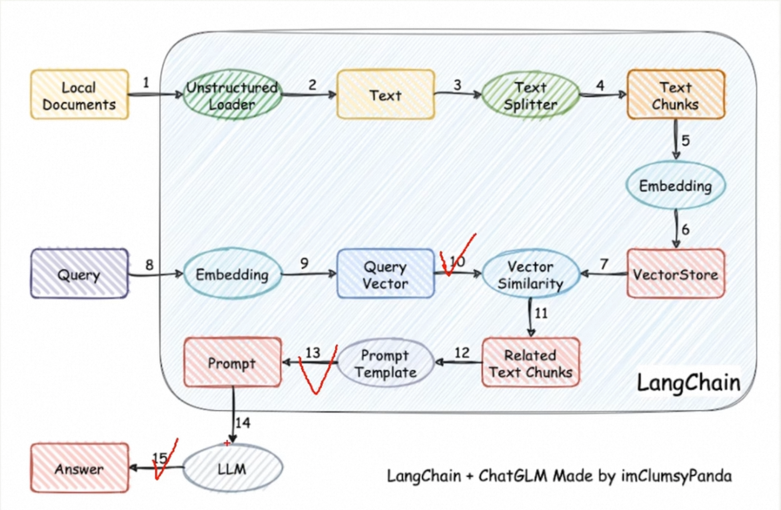
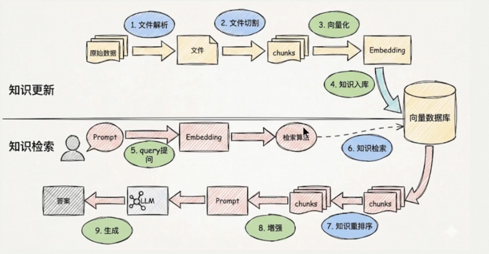

``` python
如图, 这个工程中的难点: 1. 文件解析 2. 文件切割 3. 知识检索 4. 知识重排序
1. 文件解析: 如果是 pdf, 内部包含文件, 图片, 表格, 图片上还有文字, 需要处理
2. 文件切割: 没有固定的格式
3. 在 RAG 应用中, 随着文档数量增加, 召回准确率会下降, 引入 reranker (重排器) 可对初步召回的较多 chunk (如 top20 或 top50) 进行精排, 
提高召回准确率, 防止 LLM 处理无关信息, 减少时间和成本
此外, 与基于基本矢量搜索的 RAG 相比, reranker 增强型 RAG 的成本更高, 但与仅依靠 LLM 生成答案相比, 它的成本低些
Reranker 的使用场景:
适合: 追求回答高精度和高相关性的场景中特别适合使用 Reranker, 例如专业知识库或者客服系统等应用
不适合: 引入 reranker 会增加召回事件, 增加检索延迟, 服务对响应时间要求高时, 使用 reranker 可能不合适.
```

## Agent 开发

``` python
充分利用 LLM 的推理决策能力, 通过增加规划, 记忆和工具调用的能力, 构造一个能够独立思考, 逐步完成给点个目标的 Agent(智能体)
Agent = LLM + Planning + Tools + Memory + Action
1. 大模型 (LLM) 作为 '大脑': 提供推理, 规划和知识理解能力, 是 AI Agent 的决策中枢
大脑主要由一个大型语言模型 LLM 组成, 承担着信息处理和决策等能力, 并可以呈现推理和规划的过程, 能很好地应对位置任务
2. 规划决策 (Planning): 通过任务分解, 反思与自省框架实现复杂任务处理. 例如, 利用思维连 (Chain of Thought) 将目标拆解为子任务, 并通过
反馈优化策略.
3. 工具使用 (Tool Use): 调用外部工具 (如 API, 数据库) 扩展能力边界
4. 记忆 (Memory)
智能体像人类一样, 能够存学到的知识以及交互习惯等, 这样的机制能让智能体在处理重复工作时调用以前的经验, 从而避免用户进行大量重复交互
短期记忆: 存储单次对话周期的上下文信息, 属于临时信息存储机制, 受限于模型的上下文窗口长度
ChatGPT: 支持约 8k token 的上下文
GPT4: 支持约 32k token 的上下文
最新的很多大模型: OpenAI GPT-5.5/GPT-5.4 Pro 支持 100 万 Token(1M)
Anthropic Claude Opus 4.7 支持 200 万 Token, DeepSeek-V4-Pro 支持 100 万 Token
甚至有模型支持 1000万 Token 的上下文 (相当于 2000 万字文本或 20 小时视频)
长期记忆: 可以横跨多个会话或时间周期, 可存储并调用核心知识, 非即时任务
比如, 关于用户的偏好, 过去执行过的指令等
长期记忆, 可以通过模型参数微调(固化知识), 知识图谱(结构化语义网络) 或 向量数据库(相似性检索) 方式实现
5. 行动 (Action): 实际执行决策的模块, 涵盖软件接口操作 (如自动订票) 和物理交互 (如机器人执行搬运). 比如: 检索, 推理, 编程等
智能体会形成完整的计划流程, 例如先读取以前工作的经验和记忆, 之后规划子目录并使用相应工具去处理问题, 最后输出给用户并完成反思
```

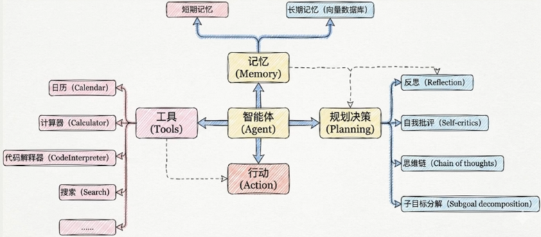

## 大模型应用开发的 4 个场景

``` python
场景1: 纯 Prompt
Prompt 是操作大模型的唯一接口
当人看: 你说一句, ta 说一句, 你再说一句, ta 再回一句
```

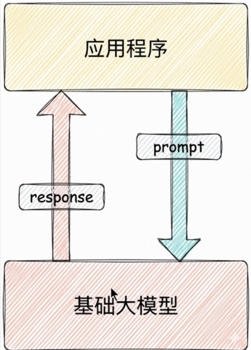

``` python
场景2: Agent + Function Calling
Agent: AI 主动提要求
Function Calling: 需要对接外部系统时, AI 要求执行某个函数
当人看: 你问 ta [我明天驱寒周出差, 需要带伞吗?], ta 让你先看天气预报, 你看了告诉 ta, ta 再告诉你要不要带伞
```

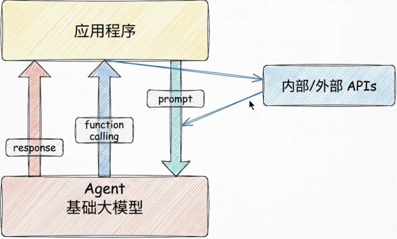

``` python
场景3: RAG(Retrieval-Augmented Generation)
RAG: 需要补充领域知识时使用
Embeddings: 把文字转换为更易于相似度计算的编码, 这种编码叫向量
向量数据库: 把向量存起来, 方便查找
向量搜索: 根据输入向量, 找到最相似的向量
```

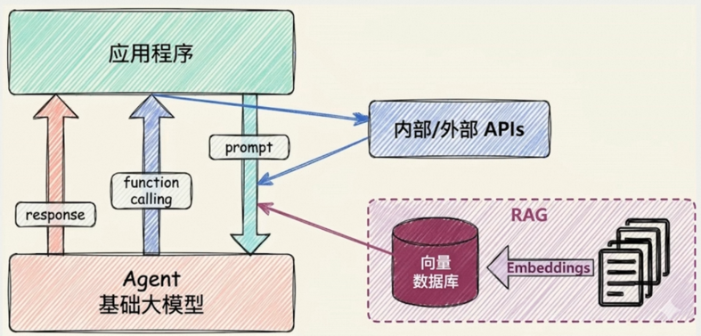

``` python
场景4: Fine-tuning (精调/微调)
努力学习考试内容, 长期记住, 活学活用
特点: 成本最高, 在前面的方式解决不了问题的情况下使用
```

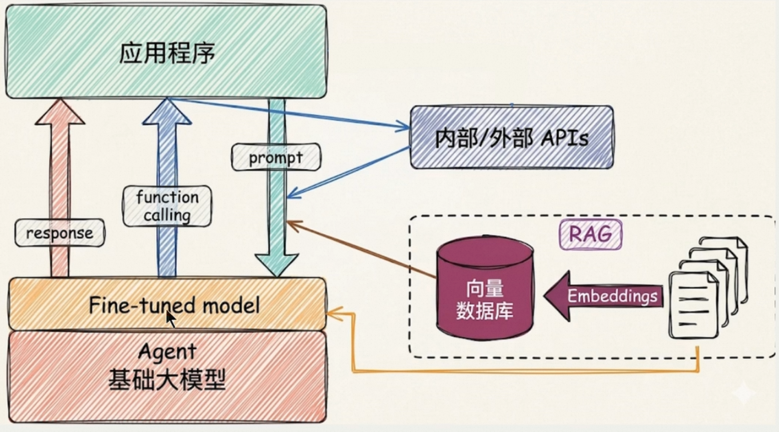

## 模型的创建与调用

### 模型初始化角度1: 使用模型提供商库

``` python
在 LangChain 中初始化模型, 主要可以通过 直接使用特定的 Model Class 和 使用统一的 init_chat_model 函数 这两种方式来实现
方式1: LangChain 为一些大模型供应商提供了专门的 Model 类, 导入对应的具体类 (如 ChatOpenAI, ChatAnthropic, ChatDeepSeek, 
ChatOllama, ChatHunyuan, ChatTongyi, ChatZhipuAI) 并进行实例化
官网链接: https://reference.langchain.com/python/langchian-community/chat-model
```

### 通过专用 API 调用

``` python
注意: 使用不同的模型可能传入的参数名称不同, 可以参考对应的源码
```

### 调用线上大模型

``` python
1. 调用具体模型厂商的 API
1.1 调用 DeepSeek 官网的 DeepSeek 模型
调用大模型涉及到三个特别重要的参数:
base_url, model_name, api_key
举例: 将参数信息存储在 .env 配置文件中

2.1 智普大模型
官网: https://www.bigmodel.cn/

3.1 阿里云百炼平台获取相关的大模型
官网: https://trial.cn-beijing.maas.aliyuncs.com/compatible-mode/v1/chat/completions
```

## 兼容用法

``` python
一方面, LangChain 没有为所有大模型厂商提供专用接口, 见 LangChain大模型集成列表. 如果选用的平台没有专用接口, 可以通过兼容接口调用
另一方面, 专用接口的对接方式五花八门, 如 腾讯混元的 ChatHunyuan 需要单独的 APP_ID + SecretId + SecretKey, 配置繁琐, 用户不友好.
结论: 大多数 API 平台都支持 OpenAI API 接口规范, 所以基本都可以通过 ChatOpenAI 集成

```

## 中转平台

``` python
受政策影响, 国内无法直接调用国外顶尖的闭源模型, 某些复杂任务需要用这些模型实现, 此时可通过中装平台曲线救国
1. OpenRouter
官网: https://openrouter.ai/
OpenRouter 是一个多模型 API 聚合平台, 提供统一的 OpenAI 兼容接口, 可以通过一个 API Key 调用 OpenAI, Claude, Gemini, DeepSeek, Qwen 等
不同厂商的大模型, 他适合用于模型对比, 模型路由, Agent 应用开发和课程实验
是目前知名度最高的中转平台, 但是使用的话, 需要 tizi 魔法
```

``` python
2. CloseAI
官网: https://www.closeai-asia.com/
Close AI 是一个面向国内用户的 AI API 中转平台, 提供 OpenAI, Claude, Gemini 等模型接口的代理访问能力, 他适合用于解决国内网络昂稳, 支付和
统一管理等问题, 常用于大模型应用开发, 教学演示和测试环境
LangChain 没有为 CloseAI 提供专用集成, 可以通过 ChatOpenAI 兼容接口调用
```

## 模型初始化角度1: init_chat_model ()

``` python
init_chat_model 是 LangChain1.x 中退出的用于初始化聊天模型的统一接口. 只要是 LangChain 支持的模型都可以处理, 他会根据模型名称自动选择
对应的模型类初始化实例
基本语法:
from langchain.chat_models import init_chat_model
model = init_chat_model(
    'provider:model_name', # 提供商: 模型名称
    api_key: 'your-api-key', # API 密钥(可选, 可从环境变量读取)
    temperature=0.7, # 温度参数(可选)
    max_tokens=1000, # 最大 Token 数(可选)
    **kwargs # 其他模型特定参数
)

问题: init_chat_model 和 直接使用 ChatTongyi, ChatOpenAI, ChatDeepSeek 有什么区别?
回答: init_chat_model 是 LangChain1.0 的统一接口, 优势包括:
统一接口: 无序记住每个提供商的不同初始化方式(以一致的方式初始化)
易于切换: 简化了智能体系统中模型切换策略(只需修改模型字符串)
简洁明了: 更简洁的语法, 减少样板代码
自动适配: 内部根据模型标识自动选择对应的驱动类(ChatOpenAI, ChatDeepSeek)
```

## 小结

``` python
调用方式:
DeepSeek 官网的 DeepSeek 模型: ChatDeepSeek(), ChatOpenAI(), init_chat_model()
阿里云百炼平台的 DeepSeek 模型: ChatTongyi(), ChatOpenAI(), init_chat_model()
OpenRouter 平台的 DeepSeek 模型: ChatOpenRouter(), ChatOpenAI(), init_chat_model()
CloseAI 平台的 DeepSeek 模型: CharOpenAI(), init_chat_model()
```

## 模型初始化参数(常用版)

```python
在 LangChain 中, Model Class 和 init_chat_model 初始化模型共同的参数及注释
API 文档: https://docs.langchain.com/oss/python/langchain/models#parameters
参数 -- 类型 -- 说明 -- 默认值
model -- str -- 使用功能的特定提供商的模型名称(必需). -- 无
model_provider -- str -- 模型提供商名称 -- 无
api_key -- str -- API 密钥. 如果不提供, 会从环境变量中读取(如 DEEPSEEK_API_KEY) -- None
base_url -- str -- 大模型供应商 API 请求地址 -- None
temperature -- float -- 控制输出随机性, 范围 0.0 - 2.0, 温度越高输出越随机 -- 0.7
    - 0.0: 最确定性, 输出几乎不变
    - 1.0: 平衡创造性和一致性
    - 2.0: 最随机, 最有创造性
max_tokens -- int -- 限制模型输出的最大 token 数量 -- None
timeout -- float -- 超时时间(秒), 超时未响应, 请求会被取消 -- None
max_retries -- int -- 请求失败(如网络问题, 速率限制)时的最大重试次数 -- 6
说明:
1. temperature 参数根据使用场景选择:
0.0 - 0.3: 需要一致性, 准确性的任务 (数学计算, 数据提取, 分类, 代码生成)
0.5 - 0.7: 平衡创造性和一致性 (聊天, 问答)
0.8 - 1.5: 创造性任务 (写作, 头脑风暴)
1.5 - 2.0: 高度创造性 (诗歌, 故事创作)
```

## Token 是什么?

``` python
基本单位: 大模型通过分词器 (Tokenizer) 将文本拆分后的最小语义单元是 token (相当于自然语言中的词或字).
不同的模型采用不同的 分词算法(如 BPE, WordPiece), 因此同一段文本在不同模型中的 Token 数量可能不同.
收费依据: 大语言模型通常也是以 token 的数量作为其计量 (或收费) 的依据
1. 1个中文 Token≈1-1.8 个汉字, 1 个英文 Token≈3-4 个字符
2. Token 与字符转换的可视化工具:
    OpenAI 提供: https://platform.openai.com/tokenizer
    百度智能云提供: https://console.bce.baidu.com/support/#/tokenizer
```

## 模型初始化角度3: 本地模型的部署与调用

``` python
Ollama 的介绍
LangChain 也支持使用 Ollama, vLLM 等框架启动的本地大模型. 这里以 Ollama 为例进行演示
Ollama 是在 Github 上的一个开源项目, 其项目定位是: 一个本地运行大模型的集成框架, 可以实现如 Qwen, DeepSeek 等主流
大模型的下载, 启动和本地运行的自动化部署及推理流程
Ollama 官方地址 https://ollama.com
```

## 模型的调用

``` python
在 LangChain 中, 模型调用 (Invocation) 是指通过特定方法触发大语言模型生成输出的过程. 根据不同的应用场景和需求, LangChain
提供了几种核心的调用方式, 主要是 invoke(), stream() 和 batch() 方法, 以及它们的一步版本 ainvoke(), astream, abatch()
invoke(): 阻塞式, 一次性返回完整结果问答, 批量处理任务, 无序实时反馈的场景
ainvoke(): 非阻塞式, 提高系统吞吐量高并发 web 应用, IO 密集型任务
stream(): 流式输出, 实时返回每个 token 聊天机器人, 长文本生成, 需要提升用户体验的交互应用
astream(): 非阻塞式, 提高系统吞吐量高并发 web 应用, IO 密集型任务
batch(): 批量处理多个输入高并发场景, 需要同时处理大量请求
abatch(): 非阻塞式, 提高系统吞吐量并发 web 应用, IO 密集型任务
```

### invoke()

``` python
invoke() 是 LangChain 中最核心的方法, 它的工作模式是阻塞式的, 即程序会等待模型完全生成整个响应后, 再一次性将结果返回给用户.
invoke 方法的作用:
1. 接收你的输入 (问题, 指令, 对话历史等)
2. 发送给 LLM 模型 (如 GPT-4, Llama, Claude 等)
3. 返回模型的相应 (文本回复 + 元数据信息)
基本语法:
    response = model.invoke(input, config=None)
参数详解
    参数 -- 类型 -- 说明 -- 必需 -- 默认值
    input -- str|list[dict]|list[Message]等 -- 你要发送给模型的内容 -- 必需 -- 无
    config -- dict -- 高级配置(回调函数, 元数据, 标签等) -- 可选 -- None
```

### 输入参数详解

``` python
invoke 方法非常灵活, 支持三种形式的输入: 文字输入, 字典列表, 消息对象列表
1. 文本输入(最简单)
简单的一次性问答, 直接传入一个问题或指令
适合场景: 快速测试, 不需要保留对话历史的简单生成任务
缺点: 无法设置系统提示 (system prompt), 无法传递对话历史

2. 字典列表(推荐, 最灵活)
创建字典列表组成消息. 一条消息通常包含 role(角色), content(内容) 等信息
适用场景: 可以设置系统提示, 表达多轮对话历史, JSON 兼容, 易于序列化和网络传输, 生成环境推荐
缺点: 代码稍微多一点(但更清晰)
格式:
message = [
    {'role': 'system', 'content': '系统提示'},
    {'role': 'user', 'content': '用户消息'},
    {'role': 'assistant', 'content': 'AI回复'},
    {'role': 'user', 'content': '继续提问'}
]
角色说明:
system(System): 设定 AI 的行为, 角色, 规则, 如: 你是一个专业的 Python 导师
user(Human/User): 用户的输入/问题, 如: 什么是装饰器
assistant(AI/Assistant): AI 的历史回复(用于对话上下文), 如: 装饰器是一种设计模式
```

### 返回值详解

``` python
invoke 返回一个 AIMessage 
方式1: response.pretty_print()
方式2: 
from rich import print as rprint
rprint(response)
AIMessage(
    # --- 核心内容 ---
    # 模型生成的最终文本答案
    content="**8**\n\nFollowing the order of operations, multiplication comes before addition:\n\n1. 3 × 2 = 6\n2. 
2 + 6 = **8**\n\n(Note: If calculated strictly left to right, you'd get 10, but standard math convention is to 
multiply first.)",
    # 模型拒绝回答的情况 (如触碰安全策略), None 表示正常回答
    additional_kwargs={'refusal': None},
    # --- 响应元数据 (API 返回的详细原始数据) ---
    response_metadata={
        'token_usage': {
            'completion_tokens': 218, # 生成回答消耗的 Token 数(输出)
            'prompt_tokens': 21, # 用户输入消耗的 Token 数(输入)
            'total_tokens': 239, # 本次交互总共消耗的 Token
            'completion_tokens_details': {
                'accepted_prediction_tokens': None, # 预测性生成 Token 数
                'audio_tokens': None, # 音频生成消耗
                'reasoning_tokens': 156, # 推理模型(如 o1)思考过程消耗的 Token
                'rejected_prediction_tokens': None # 被拒绝的预测 Token
            },
            'prompt_tokens_details': {
                'audio_tokens': None, # 输入中的音频 Token 数
                'cached_tokens': 0 # 命中的缓存 Token 数(能省钱/提速)
            },
            # --- 延迟性能监控 (单位: 毫秒 ms) ---
            latency_checkpoint: {
                engine_tbt_ms: 4, # 引擎 Token 间平均间隔时间
                engine_ttft_ms: 36, # 引擎生成首个 Token 的时间
                engine_ttlt_ms: 100, # 引擎生成最后一个 Token 的时间
                pre_inference_ms: 86, # 推理前的预处理耗时(安全审核, Token 化等预处理)
                service_tbt_ms: 4, # 服务端 token 与 token 之间生成的间隔时间, 决定了打字机效果是否丝滑
                service_ttft_ms: 280, # 服务端接收到请求到输出首字的总时间
                service_ttft_ms: 338, # 服务端完成全部输出的总时间
                total_duration_ms: 259, # 本次请求在系统中记录的总持续时长
                user_visible_ttft_ms: 194 # 用户看到第一个字跳出来等待的时间
            },
        },
        'model_provider': 'openai', # 模型供应商
        'model_name': 'glm-5.3', # 使用的具体模型版本
        'system_fingerprint': None, # 系统指纹, 用于追踪模型后端的配置变更
        'id': '20261105160603b93c63c32f7c47b3', # API 层面的响应 ID
        'finish_reason': 'stop', # 停止原因: stop(自然结束), length(长度受限)
        'logprobs': None # 对数概率(通常用于分析词汇选择的可能性)
    },
    # --- LangChain 内部标识 ---
    id='lc_run--01a1aabe-57b8-7263-8208-2267fd7d8f3b-0',
    # --- 工具调用信息 ---
    tool_calls=[], # 正常触发的外部工具调用列表
    invalid_tool_calls=[], # 触发失败或格式错误的工具调用
    # --- 统一消耗元数据 (LangChain 标准化后的消耗格式) ---
    usage_metadata={
        'input_tokens': 21, # 输入 Token 数
        'output_tokens': 218, # 输出 Token 数
        'total_tokens': 239, # 总 Token 数
        'input_token_details': {
            'cache_read': 0 # 从缓存中读取的输入数量
        },
        'output_token_details': {
            'reasoning': 156 # 包含在输出中的推理 Token
        }
    }
)
```

### 流式调用

``` python
invoke 和 stream 有什么区别?
invoke(): 同步调用, 在模型输出完成后一次性获取响应, 对于输出文本很长的场景, 用户体验不好
stream(): 流失调用, 实时返回响应片段, 调用后, 返回一个迭代器(iterator), 可以通过循环来实时处理每一个新生成的 chunk 内容块
注意: 流式输出依赖于模型供应商对于流式输出的支持
stream() 方式的优点:
1. 响应速度更快 -- 用户不必等待完整输出
2. 交互体验更流畅 -- 尤其在长文本或复杂推理场景下
3. 可实时展示模型思考过程
```

### 批量调用

``` python
batch() 方法允许你一次性 发送一组请求 (含多条独立请求), 模型会在后台并行处理, 然后返回所有结果的列表
与逐个顺序调用 (invoke) 相比, 能大幅 减少网络往返开销 和 等待时间, 显著提升性能, 降低成本
适用场景: 文档摘要, 批量问答, 数据预处理, 多样本分类等

一次性接收所有响应
batch() 特点是等待所有请求处理完毕, 按原始输入顺序返回结果列表
batch_as_completed() 特点是按照完成顺序接收响应
```

### 异步调用

``` python
同步(sync):
概念: 发起一个任务之后, 需要等待该任务完成后, 才能继续执行后续任务
表现: 当前执行流 会被[阻塞]
异步(async):
概念: 发起一个任务之后, 不必等待任务完成, 就可以继续执行其他任务
备注: 虽然不必等待任务完成, 但任务完成后, 仍然可以通过特定方式获取结果
表现: 当前执行流不会被[阻塞]
在 LangChain 框架中, 异步方法(ainvoke, astream, abatch) 与他们的同步版本相比, 具备如下特点:
1. 避免阻塞主线程: 同步调用会阻塞程序执行, 而异步方法让应用程序在等待 API 响应时保持响应性
2. 优化资源利用: 异步操作可以更高效的利用系统资源, 减少空闲等待时间
```

### 如何处理 API 调用失败

```python
使用 try-except 块捕获异常:
try:
    response = model.invoke('Hello')
    print(response.content)
except ValueError as e:
    print(f'配置错误: {e}')
except ConnectionError as e:
    print(f'网络错误: {e}')
except Exception as e:
    print(f'未知错误: {e}')
```

## 扩展内容

### 模型的配置信息 profile

``` python
LangChain 1.1 及更高版本可以通过 profile 属性查看模型的配置信息
这是 LangChain 针对模型的能力画像, 但是否存在, 取决于 LangChain 在集成模型厂商的服务时是否声明了能力画像
model = init_chat_model(
    model='glm-5.3',
    model_provider="openai",
    api_key=ZHIPUAI_API_KEY,
    base_url=ZHIPUAI_API_BASE_URL,
    max_tokens=10
)
print(model.profile)
# {} 说明: LangChain 没有声明 DeepSeek 官方模型的能力画像
```

## 模型初始化的参数(完整版)

### 1. 查看所有初始化参数

```python
以 ChatDeepSeek 类为例, 其参数可以由 自身定义 或 从父类 BaseChatModel 继承. 直接查看源码也很难拼凑完整列表. 这里通过
查看 ChatDeepSeek 的类属性 model_fields 来获取完整参数列表.
1. 查看 ChatDeepSeek 支持的完整参数列表
from langchain_openai import ChatOpenAI
rprint(ChatOpenAI.model_fields.keys())
2. 查看 init_chat_model 的某 model_provider 支持的完整参数列表
```

### 2. 模型类的参数构成

```python
以 ChatDeepSeek 为例, 完整参数列表由如下几部分构成:
1. 客户端与连接参数(Networking)
这类参数决定了代码 '怎么连到服务端', 而不是 '让模型怎么生成'
参数名 -- 说明
api_key/openai_api_key -- 鉴权密钥, DeepSeek 通常兼容 OpenAI 接口格式
api_base/openai_api_base -- 接口地址(如 [https://api.deepseek.com](https://api.deepseek.com))
request_timeout -- 网络请求超时时间
max_retries -- 请求失败时的重试次数
http_client/http_async_client -- 手动传入 httpx.Client 实例(用于更复杂的网络配置)
openai_proxy -- 代理服务器配置
default_headers/default_query -- 每次请求时默认携带的 HTTP Header 或 Query 参数

2. 模型推理参数(Model Inference)
这些是直接传递给 DeepSeek 模型 API 的参数, 决定了 生成内容 的质量和风格.
model_name -- 指定具体的模型(如 deepseek-chat 或 deepseek-reasoning)
temperature -- 采样温度, 越高越随机
top_p -- 核采样参数
max_tokens -- 最大输出 token 数
stop -- 停止符列表
streaming -- 是否开启流式输出
n -- 生成几个候选回复
reasoning -- 是否启用推理模式
reasoning_effort -- (DeepSeek R1 特色) 控制思考链 (COT) 的深度
presence_penalty/frequency_penalty -- 惩罚项(存在惩罚, 频率惩罚), 用于减少内容重复
store -- 是否存储对话
logit_bias -- 调整特定词汇出现的频率

3. LangChain 框架通用参数
由 LangChain 的 BaseChatModel 定义, 所有其子类 Chatxxx 都具备的, 用于管理 LangChain 内部的逻辑 (日志, 回到, 元数据), 仅在内部生效
name -- 给模型实例起个名字, 用于在 Trace (如 LangSmith) 中区分
verbose -- 是否打印详细日志
callbacks -- 回调处理器, 用于集成 LangSmith 或 自定义监控
tags/metadata -- 用于标记该实例的标签和元数据
cache -- 是否缓存该模型的请求结果
rate_limiter -- LangChain 内部的频率限制器

4. 高级与特定扩展单数
这类参数通常用于特定场景, 或为了保持与 OpenAI 协议的兼容性而存在
底层客户端访问: client, async_client, root_client (这些通常是内部生成的 SDK 实例, 不建议在初始化时手动传参)
透传参数: model_kwargs, extra_body (如果你想传递 DeepSeek API 支持但 LangChain 还没定义的参数, 可以写在这里)
功能开关: disable_streaming, include_response_headers (决定是否在输出中包含 Header)
兼容性参数: openai_organization, service_tier, store (这些多为 OpenAI 遗留参数, DeepSeek 实际使用较少)

参数: model_kwargs
用于存放哪些 OpenAI Compatible API 支持, 但 LangChain 没有直接列出的字段, 如用于支持 Function Call 的 tools 字段
说明: 此处为了演示 model_kwargs 的作用, 直接传递了 tools 字段, 实际开发中, 我们会使用专门的工具调用接口, 不会采用这种原始的方式

参数: extra_body
用于存放模型厂商基于 OpenAI API 协议扩展的字段
查阅 OpenAI Chat Completions 文档 和 DeepSeek 对话不全 API 文档 可知, thinking 是 DeepSeek 扩展字段, 用于控制是否启动思考模式

5. 模型调用中 config 参数
在调用模型时 (如使用 invoke(), ainvoke(), stream(), batch() 等方法时), 我们可以传入 config 参数
config 参数: 允许在调用模型时, 动态地配置和控制模型的行为, 而无需在初始化时就固定所有参数, 这为应用带来了极大的灵活性和可维护性
关于 config 中可配参数的解释参考:
https://reference.langchain.com/python/langchain-core/runnables/config/RunnableConfig
```

## LangSmith 基本使用

### LangSmith 概述

#### 什么是 LangSmith?

```python
LangSmith 是 LangChain 生态系统中专门用于 LLM (大语言模型) 应用调试, 监控, 评估和管理 的平台
追踪(tracing): 记录每次 LLM 调用的详细信息
监控(monitoring): 实时查看应用性能
调试(debug): 排查问题和优化性能
评估(evaluate): 系统化测试 LLM 应用
```

```python
1. 准备账号
    1. 访问 LangSmith 官网: https://smith.LangChain.com/
    2. 自由选择注册或登录方式
    3. 登录成功

2. 创建 API key

3. 新增环境变量
    在 .env 配置文件中, 添加四个环境变量:
    # 是否启用 Langsmith 监控功能
    LANGSMITH_TRACTING=true
    # Langsmith 监控 WebUI 地址
    LANGSMITH_ENDPOINT=https://api.smith.LangChain.com
    # 创建的 API_KEY
    LANGSMITH_API_KEY=<YOUR_API_KEY>
    # 自定义项目名称, 可以在 Langsmith WebUI 监控页面根据名称查看对应的运行记录
    LANGSMITH_PROJECT="pr-clear-harmony-32"
```

## 消息与提示词模版

### 1. 认识消息

```python
大模型没有记忆, 它的输出只和输入模型的内容有关 (上下文). 很多大模型 API 服务也没有在服务端维护会话历史, 是 '无状态' 的, 因此, 如果应用需要 '记住' 对话历史,
需要在程序中维护消息列表
在 LangChain 中, Message(消息) 是模型交互的最基本单位. 它既代表模型接收到的 输入(Input), 也代表模型生成的 输出(Output)
每一轮与大模型的对话, 都有一条或多条 Message 构成. 每个 Message 不仅包含 文字内容, 还携带描述上下文状态的 元信息(metadata), 用于保持对话的一致性和可追踪性.
比如, 模型在多轮交互中理解 '谁在说话', '说了什么', '这条信息属于那一轮对话'
LangChain 在 1.0 中提供了 跨模型统一的 Message 模型, 无论你使用的是 OpenAI, Anthropic, Gemini 还是本地模型, 这一标准都能保持一致的行为.
好处:
兼容性强: 不同模型的消息格式自动对齐
可扩展性高: 方便添加多模态内容或自定义字段
可追踪性好: 为 LangSmith 等调试工具提供一致的上下文数据结构
```

#### 1.1 消息的内部结构

```python
LangChain 的消息(Message)对象包含三种字段
Role: 消息所属的角色或类型, 如 system, user, assistant
Content: 消息内容
Metadata: (可选)元数据, 存储额外信息. 如: 消息ID, 响应时间, token 消耗量, 消息标签等
```

#### 1.2 消息的类型

```python
LangChain 定义了很多消息类型, 通过 role 区分, 常用的有四种.
1. 系统消息
也称为系统提示词, 用于在对话开始时模型设定角色, 行为准则和上下文背景. 它像是给 AI 助手的一份工作说明书, 决定了其回答问题的风格, 领域和专业范围
{"role": "system", "content": "你是个精通编程的软件架构师"}
2. 用户消息
也称为用户提示词, 在多轮对话中, 他表示用户的一次输入. 可以包含简单的文本问题, 也可以是复杂的多模态内容(如 图片, 音频, 文档等)
3. 助手(AI)消息
代表模型的回复, 包括生成的文本, 工具调用, 元数据等
{"role": "assistant", "content": "我很高兴认识你"}
{
    "role": "assistant",
    "content": "",
    "tool_calls": [
        {
            "name': "get_weather",
            "args": {
                "location": "北京"
            },
            "id": "..."
        }
    ]
}
4. 工具调用消息
工具调用结果匹配的消息类型, 将此消息返回给模型, 让模型基于这个结果继续生成回复. 在 Tools 一截详细介绍
{
    "role": "tool",
    "content": "今天天气很好",
    "tool_call_id": "..."
}
问题: 为什么使用不同的消息类型?
明确角色: 清晰区分系统提示, 用户输入和 AI 回复
控制行为: 通过 SystemMessage 精准控制 AI 的行为
对话历史: 构建完整的多轮对话上下文
调试友好: 更容易追踪和调试对话流程
```

#### 1.3 消息格式

```python
格式1: JSON 格式
1. 系统消息
{"role": "system", "content": "你是一个善解人意的助手"}
2. 用户消息
{"role": "user", "content": "你好啊"}
3. 助手消息
{"role": "assistant", "content": "我也很高兴认识你"}
4. 工具调用消息
{"role": "tool", "content": "<工具输出>", "tool_call_id": "..." }
格式2: 对象格式
1. 系统消息
SystemMessage(content="你是个善解人意的助手")
2. 用户消息
HumanMessage(content="你好啊~")
3. 助手消息
AIMessage("我也很高兴认识你")
4. 工具调用消息
ToolMessage(
    content="<工具输出>",
    tool_call_id="..." # 一定要和 AI 消息中的调用 ID 匹配
)
```

#### 1.4 消息对象字段说明

```python
SystemMessage 参数列表
content: 消息内容, 字段名可省略
SystemMessage(content="你是一个友好的 AI 助手") == SystemMessage("你是一个友好的 AI 助手")
HumanMessage 参数列表
HumanMessage(content="1+2=?") == HumanMessage("1+2=?")
metadata: 元数据字段, 可以有很多, 自定义
HumanMessage(
    content="Hello",
    name="alice", # 可选, 用户名
    id="..." # 可选, message 的 ID
)
name 和 id 都属于元数据字段, 当消息类型相同, 对消息进行区分. 但不是所有模型都支持这一功能, 是否支持取决于模型供应商, 需要查看官方手册.
```

#### 1.5 ToolMessage 参数列表(拓展)

```python
content: 文件内容
name: 工具名称
tool_call_id: 工具调用唯一 ID, ToolMessage 必须紧邻匹配的 AIMessage, 和前者 tool_calls 中的 id 一致
ToolMessage(
    content="<工具输出>",
    name="get_weather",
    tool_call_id="..."
)
```

#### 1.6 拓展-消息属性: content, content_blocks

```python
content:
消息的 content 可以理解为数据内容, 他是弱类型的, 支持字符串和列表(列表元素通常为字典)
举例1: 存储字符串
如果只是纯文本内容, 直接传递字符串就好
msg1 = HumanMessage("你好")
说明: 当 content 内容只是字符串时, 可以省略参数名称

举例2: 存储字典列表
如果需要发送的不只是文本, 如多模态内容, 则需要 content 的 字典列表 形式
字典内容遵循模型供应商的 API 规

content_blocks
在 LangChain 1.x 中, content_blocks 是消息对象 (BaseMessage) 的一项重大提升, 它的核心目标是提供一种 跨模型供应商, 
标准化的多模态数据结构
过去, 处理图片, 音频, 甚至是模型生成的 '思维链(Reasoning)' 内容时, 不同的供应商(OpenAI, Anthropic, Google) 等的
API 格式各异, 导致开发者需要写大量的适配代码. content_blocks 的出现终结了这种混乱.
在 LangChain 1.2 版本中, 消息对象的 content 属性依然存在(为了向前兼容), 但新增了 content_blocks 属性, 可以将 content
解析为标准, 类型安全的表示.
数据结构: 他是一个 list[TypedDict]
统一格式: 每个 block 都有一个 type 字段, 用于区分内容类型
支持类型: 包括 text(文本), image(图片), audio(音频), video(视频), tool_call(工具调用)以及reasoning(推理/思维链)
支持字段类型详见: https://docs.langchain.com/oss/python/langchain/messages#openai
1. 输入格式化
对于复杂的对话(带图片或工具结果), 建议使用 content_blocks 列表形式构建 HumanMessage 或 AIMessage
借助 content_blocks, 我们可以用一套标准代码, 无缝的在不同厂商的模型之间切换
2. 输出格式化
content_blocks 还可以用于输出格式化, 不同的模型其输出格式可能不同, 仅为提供思考内容, 切换模型都可能需要更改代码, 非常不方便
content_blocks 提供了 统一的输出格式, 可以将不同格式的响应统一为标准格式
注意: content_blocks 是懒加载的, 即调用时才会解析
```

### 2. 提示词模版(Prompt Templates)

#### 2.1 为什么推荐提示词模板?

```python
在 LangChain 开发中, 构造提示词既可以直接使用 Python 字符串拼接(如 f-string, format() 或 +), 也可以使用 LangChain 提供的 
PromptTemplate 或 ChatPromptTemplate

例1: 字符串拼接方式
topic = "python"
difficulty = "初学者"
prompt_str = f"你是一个{difficulty}级别的编程导师, 请用简单易懂的语言解释{topic}"
response = model.invode(prompt_str)
print(f"AI 回复: {response.content}...\n")
优点: 
简单直接, 上手快
适合临时 demo
无额外学习成本
缺点:
可读性差(变量多时混乱)
不易维护(修改容易出错)
无变量校验(容易漏/拼错)
难以支持复杂场景(多轮对话/RAG/Few-shot)

例2: 提示词模版
写法1:
from langchain_core.prompts import PromptTemplate
topic = "Python"
difficulty = "初学者"
template = PromptTemplate.from_template(
    "你是一个{difficulty}级别的编程导师。请用简单易懂的语言解释{topic}。"
)
prompt = template.format(difficulty=difficulty, topic=topic)
response = model.invoke(prompt)
print(f"AI 回复: {response.content}...\n")

写法2:
from langchain_core.prompts import ChatPromptTemplate
prompt_template = ChatPromptTemplate([
    ("system", "你是一个AI开发工程师. 你的名字是 {name}."),
    ("human", "{user_input}")
])
prompt = prompt_template.invoke({"name": "xxx", "user_input": "你能帮我做什么?"})
print(prompt)
优点: 
结构清晰(变量占位)
易维护, 可复用
自动变量校验(更安全)
支持复杂场景(对话/RAG/Agent)
可与 LangChain 生态无缝集成
便于调试与日志追踪
缺点:
有一定学习成本
初期写法略复杂
对极简单场景略重
```

#### 2.2 提示词机制演进

```python
LangChain 1.0 的架构变革中, 核心的演进之一体现在 Prompt 机制上: 
一个结构化的, 复函元数据的消息列表已经取代单一字符串, 成为与模型交互的标准数据格式

1. 旧时代: LLM + PromptTemplate (输入与输出均为字符串)
1_ 模型接口: 对应于 LangChain 中的 LLM 类, 主要面向早期的 文本补全模型
2_ 工作模式: 模型接受一个单一的字符串作为输入, 基于此预测并生成后续的文本内容(文本补全)
3_ Prompt 工具: 核心工具是 PromptTemplate, 它的职责是接受一组变量, 并通过模板渲染, 最终输出一个完整的字符串
4_ 局限性: 当我们需要用这种方式模拟多轮聊天时, 开发者必须在字符串中手动拼接和伪造对话角色
这种方式不仅导致 Prompt 的结构混乱, 难以维护

2. 新时代: ChatModel + ChatPromptTemplate (输入与输出均为消息列表)
1_ 模型接口:对应 LangChain1.0 的主流接口 ChatModel
2_ 工作方式: 现代聊天模型 API 已原生 支持角色概念. 他不再接受单一字符串, 而是要求输入 一个结构化的消息列表. 为构建
复杂, 可靠的多轮对话智能体系统奠定了坚实的基础
3_ Prompt 工具: ChatPromptTemplate 因此成为 LangChain 1.0 中最核心的 Prompt 工具, 它的责任是接收变量, 并输出
一个 List[BaseMessage](消息列表), 该列表可直接传递给聊天模型
二者对比:
PromptTemplate: 
输出格式: 纯文本字符串
角色: 无
对话历史: 不支持
适用场景: 简单提示
ChatPromptTemplate:
输出格式: 消息列表
角色: system/user/assistant
对话历史: 支持
适用场景: 聊天, 对话, 多轮交互
因此, 用于生成消息列表的 ChatPromptTemplate 自然去代理生成字符串的 PromptTemplate, 成为构建现代 LangChain 应用的首选
```

#### 2.3 ChatPromptTemplate 的使用

```python
在 LangChain1.0 中, ChatPromptTemplate 是用于生成消息列表的核心组件, ChatPromptTemplate 是创建聊天消息列表的提示模板.
他比普通 PromptTemplate 更适合处理多角色, 多轮次的对话场景. 支持 System/Human/AI 等不同角色的消息模板.
消息类型: 
system -- 系统消息 -- 设定 AI 的行为, 角色, 规则
user/human -- 用户消息 -- 用户的输入/问题
assistant/ai -- AI 消息 -- AI的回复(用于对话历史)

两种实例化方式
ChatPromptTemplate 可以通过 初始化方法 或 from_messages 方法来实例化提示词模板. 实例化时需要传入 messages 参数. 常见类型
是: tuple 构成的列表, 参数类型 (role: str, content: str)
方式1: 调用 from_messages() 推荐
该方法允许传入一个由元组 (Tuple) 构成的列表, 列表中的每一个元素都代表一条具有特定角色的消息
```

#### 2.4 高级特性

```python
1. 部分变量与填充: partial()
与填充某些固定不变的变量, 创建模板的变体
使用场景:
某些变量在所有调用中都相同
需要为不同用户/场景创建定制模板

2. 消息占位符
当你不确定消息提示模板使用什么角色, 或者希望在格式化过程中 插入消息列表 时, 该怎么办? 
这就需要使用消息占位符, 负责在特定位置添加消息列表
使用场景: 多轮对话系统存储历史消息以及 Agent 的中间步骤处理此功能非常有用 
```

## Tools

### Tools 概述

#### 1.1 工具的重要性 (智能体和大模型的本质区别就是是否可以调用工具)

```python
要构建更强大的 AI 工程应用, 只有生成文本这样的 纸上谈兵 能力自然是不够的
工具是赋予大模型 与外部世界交互能力 的关键组件, 从而能让智能体执行搜索, 计算, 数据库查询, 邮件发送或调用第三方 API 等, 进而构建功能强大
的 AI 应用, 借助工具, 大模型才能从 认识世界 走向 改变世界
```

#### 1.2 工具调用的方式

```python
在 LangChain 中, 工具 (Tools) 实际上是指明确定义了输入和输出的 可调用函数, 因此, 工具调用(Tool Calling) 也被称为函数调用(Function Calling)
方式1: 直接调用
方式2: 基于模型进行调用
```

#### 1.3 工具调用的整体流程

```python
大模型能根据对话上下文决定合适调用工具以及传递哪些参数
经典流程如下: 
```

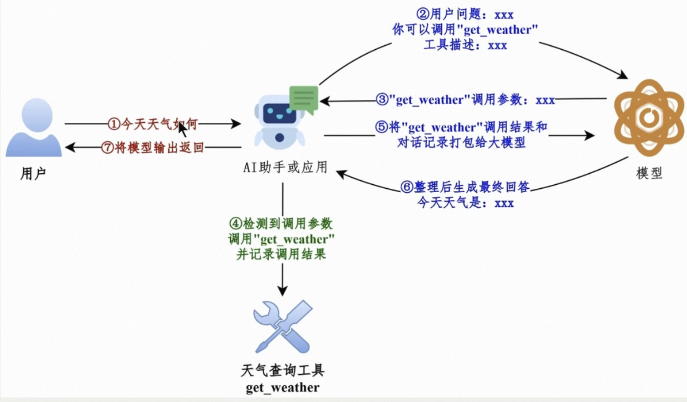

#### 1.4 从 Message 流转看工具的调用


### 2. 工具的定义方式1: 不使用@tool

#### 2.1 模型绑定工具并发送请求

#### 2.2 工具描述的各部分详解

```python
1. 了解: convert_to_openai_tool
执行 model.bind_tools([get_weather]), 底层最终会调用 convert_to_openai_tool 生成工具描述.
所以我们可以直接调用后者查看解析后的工具描述.

```

### 3. 工具的定义方式2: 使用 @tool 装饰器(推荐)

```python
使用 @tool 装饰器修饰符, 可以自动将普通 python 函数转化为智能体可调用的工具,
此方式最直接, 代码量极少, 非常适合快速验证想法或创建参数简单的工具
```

#### 3.1 自定义工具描述: description

```python
情况1: 仅提供 docstring 信息
在 bind_tools() 调用时, 现将函数封装为 BaseTool 类型的对象, 再传递给 convert_to_openai_tool 函数, 生成工具的描述
 
```

### 4. 工具的应用案例

### 5. 拓展: 强制使用工具

#### 5.1 tool_choice 参数说明

```python
bind_tools 可以传递参数 tool_choice, 用于控制是否强制使用工具
该字段最终会作为 payload 的 tool_choice 字段传递给模型, OpenAI 和 DeepSeek 官方 API 服务对于 tool_choice 的取值做了相同的规定
none: 模型不会调用任何工具
auto: 默认值, 模型可以自主决定不调用或调用任意数量的工具
required: 如果大模型决定要使用工具, 就必须使用
此外, tool_choice 还支持传递 any, 等价于 required
```

#### 5.2 none 值举例

## 结构化输出(Structured Output)

### 1. 结构化输出概述

#### 1.1 什么是结构化输出

```python
LangChain 的结构化输出 (Structured Output) 指的是:
要求模型最终返回一个符合预定义结构的数据对象, 例如固定字段的 JSON, Pydantic 模型, TypedDict, 而不再是无格式的自然语言文本
它的核心目标是把 "自然语言回答" 变成 "程序可以稳定消费的数据"
例如: 不是让模型输出:
盗梦空间在 2010 年上映, 导演是克里斯托弗, 评分9.3
而是让他输出成以下结构:
{
    "title": "盗梦空间",
    "year": 2010,
    "director": "克里斯托弗",
    "rating": 9.3
}
这样做的价值主要有三点:
更容易被代码处理: 下游系统可以直接读字段, 而不是再从自然语言里做解析
结果更稳定: 减少 "模型说法变量但意思差不多" 导致的解析失败
更适合工程化: 适用于表单抽取, 分类, 路由, 调用工具参数生成, 工作流状态传递等场景
```

#### 1.2 传统方式 VS 结构化输出

```python
1. 传统的几种方式 (繁琐, 不推荐)
提示词要求 JSON
手动解析
手动验证类型
手动创建对象
2. 结构化输出 (简洁)
# 一步到位
structured_llm = model.with_structured_output(Person)
person = structured_llm.invoke("张三是一名30岁的软件工程师")
# 自动解析, 验证, 创建对象
为什么第2种结构化输出机制这么受欢迎?
在没有 Pydantic 等结构化方案之前, 开发者需要大量 prompt 苦口婆心的求大模型 "请返回 JSON,
不需要带任何解释", 然后自己繁琐的 json.loads() 和 try...except.
而有了 Pydantic 等结构化方案结合 .with_structured_output() 之后:
Prompt 变干净了: 字段的 description 直接充当了 Prompt 的一部分
类型安全: 编辑器的自动补全, 代码运行前就能做类型检查
极其稳定: 依托大模型厂商底层的 JSON 模式, 输出错误率降到了极低
```

#### 1.3 结构化输出模型

```python
目前 LangChain 1.x 支持多种 Schema 的结构化输出方式:
Pydantic (字段校验, 描述, 嵌套结构, 功能最丰富)
TypedDict (轻量类型约束)
JOSN Schema (与前后端/跨语言接口最通用)
dataclass
模型对象可以调用 with_structured_output() 绑定输出模式(schema).
只有 Pydantic 返回的是 Schema 类实例, 其余三种方式返回的都是 字典, 也只有 Pydantic 在类型不匹配时会抛出异常

问题: 现在所有模型都支持 以上结构化输出方式吗?
大部分现代模型支持 (通过函数调用):
```

### 2. 四种模式的使用

#### 2.1 模式1: Pydantic

```python
他通过在运行时强制执行类型提示, 确保数据的正确性和一致性, 是 生产场景首选.
1. 基本使用
需要满足的几个要素:
所有结构化输出的数据模型都必须继承 BaseModel
使用 类型提示. Pydantic 支持丰富的字段类型: str, int, float, List[xxx], Optional[xxx] 等
使用 Field() 添加字段默认值和描述, 帮助 LLM 理解字段含义

```

#### 2.2 TypedDict

```python
TypedDict 是 Python3.8+ 引入的一种类型提示工具, 即带有类型声明的字典结构. 适合需要快速定义字典结构且
无 Pydantic 重量级功能的场景
1. 普通 dict 没有类型信息
{
    "title": "盗梦空间",
    "year": 2010,
    "director": "颗粒",
    "rating": 9.3
}
2. TypedDict 可以进一步说明
这个字典应该有哪些字段
每个字段的类型是什么
TypedDict 主要是 类型声明, 不是运行时强校验器
3. Annotated 的使用
Annotated 用来在"类型"之外, 在附加一些额外信息, 即元数据. 类似于 Pydantic 的 Field
基本形式:
Annotated[类型, 附加信息1, 附加信息2, ...]
举例的前提:
使用 CloseAI 平台的 gpt 模型:
4. @dataclass
@dataclass 是 Python 标准库 dataclasses 提供的类装饰器, 用于简化"以字段为核心"的数据类定义
给类加上 @dataclass 后, Python 会根据字段声明自动生成常用方法, 例如:
__init__
__repr__
__eq__
因此, 从对象行为上看, @dataclass 创建的类, 常常近似于手写这些方法的普通类
from dataclasses from dataclass
@dataclass
class Movie:
    title: str
    year: int
    director: str
    rating: float
注意: 虽然 @dataclass 的行为上接近于手写 __init__, __repr__, __eq__ 的普通类, 但二者并不完全等价.
@dataclass 修饰后的类仍然是普通的Python 类, 但他会被标准库标记为数据类, 并携带 dataclass 的字段元信息,
手写__init__等方法的普通类不能代替@dataclass 修饰的类.
前者可以作为 Langchain 的 Schema, 而后者不行
```

### 3. 关于类型校验

#### 3.1 fake server

```python
验证不同 schema 定义方式在数据格式不匹配时的处理方式

fake server
我们构造一个虚拟的 DeepSeek 服务端, 客户端接收到的响应是 人为构造 的, 主要目的是为了观察不同模式下 LangChain 会从响应中的
哪些字段中抽取信息
```

### 4. 获取结构化结果方式

```Python
以上定义输出结构的四种模式中你, 我们都是通过调用 "with_structured_output" 来获取结构化输出结果, 除了这种方式外, 还可以通过使用
输出解释器来获取结构化输出结果, 下面介绍这两种获取结构化结果的方式

1. 使用 with_structured_output
这种方式是 最新, 最简洁的 API, 直接让模型 "理解" 你需要的数据结构, 并返回解析好的对象.
此外, 我们可以在 with_structured_output 方法中传入 include_raw=True 参数, 表示返回解析前的原始 AIMessage, 从而访问令牌用量
等元数据
2. 使用输出解析器(不推荐)
这种方法更传统, 依赖于在提示词中明确指示模型输出特定格式的文本, 然后使用解析器进行转换
其流程是: 提示词指导(引导生成指定类型) -> 模型生成文本 -> 解析器转换
```

## 智能体

### 1. 理解 Agents

```python
通用人工智能 (AGI) 将是 AI的终极形态, 几乎已成为业界共识. 同样, 构建智能体(Agent) 则是AI工程应用当下的 "终极形态", 即 Agent 是
大模型应用开发的核心
```

#### 1.1 什么是 Agent?

```python
在大模型应用开发中, 智能体通常指一种以 大语言模型为推理与决策核心, 结合 记忆, 工具调用 与 环境交互能力, 能够进行规划决策并执行复杂任务
以达成目的的软件系统

Agent 的关键能力:
理解用户问题
如何拆解任务
判断是否需要工具
如何利用好工具结果生成回答和推进任务
```

#### 1.2 Agent 的核心组件

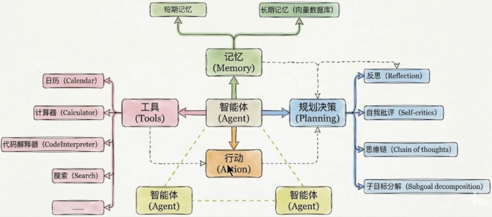

```python
实际开发中几个要素并不需要同时出现, 总结:
必须的: 行动(Action)
几乎总是存在的: 工具(Tool)
有条件存在的: 规划决策(Planning)
最容易被省略的: 记忆(Memory)
```

#### 1.4 Agent 创建与调用

```python
1. 全新调用
LangChain 在 1.0 版本后, 团队做出了彻底重构: 将所有 Agent 的创建方式统一为一个入口: create_agent(). 它取代了旧版本中的 
create_react_agent, create_json_agent, create_tool_calling_agent 等多种分支函数, 真正让开发者用一行代码即可创建
任何类型的智能体
同时在底层通过 "中间件机制(Middleware) 和 标准模型接口(invoke/stream)"实现全局统一, 这让框架更轻, 更稳, 也更易于集成到
其他 Agent 平台中
from langchain.chat_models import init_chat_model
from langchain.agents import create_agent
# 1. 初始化模型
model = init_chat_model(
    model='glm-5.3',
    model_provider="openai",
    api_key=ZHIPUAI_API_KEY,
    base_url=ZHIPUAI_API_BASE_URL
)
# 2. 创建 Agent
agent = create_agent(
    model=model,
    tools=[tool1, tool2],
    system_prompt="Agent 的行为指令" # 可选
)
# 3. 调用
result = agent.invoke({
    "messages": [
        {"role": "user", "content": "问题"}
    ]
})
```

### 2. Agent 的基本用法1: 模型的传入方式

```python
在 LangChain 1.2 中, create_agent 是构建智能体的核心方式, 底层基于 LangGraph 实现

create_agent 完整参数:
from langchain.agents import create_agent
agent = create_agent(
    # 必需: 聊天模型
    model: str|BaseChatModel,
    # 必需: 工具列表
    tools: List[BaseTool],
    *,
    # 系统提示词
    system_prompt: str = "",
    # 中间件
    middleware: Seguence[AgentMiddleware[StateT_co, ContentT]] = (),
    # 在某些工具前暂停(人机协作)
    interrupt_before: List[str] = None,
    # 在某些工具后暂停
    interrupt_after: List[str] = None,
    # 调试模式
    debug: bool = False,
    # 设置模式名称
    name: str | None = None
)
Agent 在创建时, 涉及到模型(Agent 使用的模型), 可调用工具, 系统提示词等参数的设置
更多参数参考: https://reference.langchain.com/python/langchain/agents/factory/create_agent
Agent 中模型的传入方式:
模型是 Agent 的 "大脑", 负责决策和推理, 根据模型传入 agent 方式的不同, 分为两种方式
```

#### 2.1 传入模型字符串

```python
Agent 根据传入的模型字符串, 自主创建模型对象
```

### 3. Agent 的基本用法2: 如何调用 Agent

```python
agent.invoke() 是 Agent 最基本的同步调用方法, 他会阻塞程序执行直到返回最终结果. 具体的:
输入: 传入的参数为字典类型, 字典内通过 messages 字段传递消息列表. 即 '{"mesages": [{"role": "...", "content": "..."}]}'
输出: 通过 invoke 调用 Agent, 底层可能会经历多轮交互, 返回的是完整的消息列表, 被封装在字典中, 是 messages 字段的值
from langchain_core.messages import HumanMessage, AIMessage, ToolMessage

response = agent.invoke({"messages": [

]})
# response 是字典类型
# {
#     "messages": [
#         # 用户问题
#         HumanMessage(),
#         # AI 工具调用
#         AIMessage(),
#         # 工具返回结果
#         ToolMessage(),
#         # 最终回答 通常是这个
#         AIMessage()
#     ]
# }

# 获取最终回答
# final_answer = response["messages"][-1].content
```

### 4. Agent 的基本用法3: 绑定工具

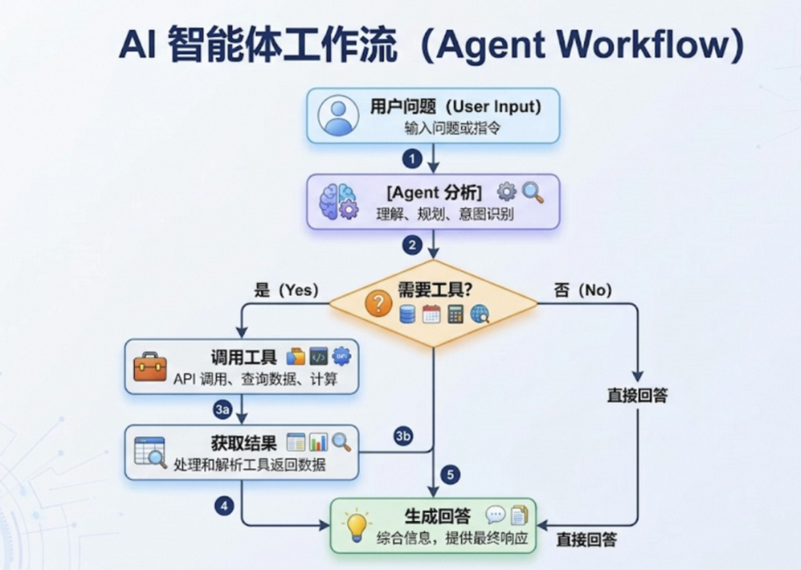

```python
只有接入了一些工具, create_agent 完成 Agent 创建才算完整
Agent 支持静态和动态绑定工具, 后者需要用到中间件
在执行时: 这里的工具可以是 LangChain 内置的, 也可以是自定义的. LangChain 生态中已经内置集成了非常多的实用工具, 开发者可以快速调用
这些工具完成更加复杂工作流的开发
LangChain 内置工具列表: https://docs.langchain.com/oss/python/integrations/tools

接入内置工具:
https://www.tavily.com
```

### 5. Agent 的高级用法1: 设置Agent名称

#### 5.1 用法

```python
创建 Agent 时, LangChain 允许用户指定其名称

```

#### 5.2 经典使用场景

```python
name 在 Multi-Agent 场景中最长被提及, 用于区分不同的 Agent. 但它的作用并不局限于多 Agent 编排. 在实际工作中, 出现如下场景, 通常都建议
为 Agent 设置一个清晰且稳定的 name

1. 流式输出归因
在启用流式输出时, name 可用于 表示当前输出内容来自哪个 Agent
这在多 Agent 协作, Agent 嵌套调用, 或前端需要实时展示不同执行主体输出时尤其有用, 便于准确区分 token 或 事件的来源

2. 消息身份标记
设置 name 后, Agent 产生的 AIMessage 会携带对应的 name 信息
这使得系统在 保存会话记录, 回访执行过程, 构建审计日志 或 前端展示消息角色 时, 能够明确识别消息的生成者

3. 调试与 trace 可读性
在调试, 日志分析和链路追踪过程中, name 可以作为 Agent 的稳定标识, 帮助开发者快速判断当前执行的是哪个 Agent
当系统中存在多个能力相近的 Agent, 或一个 Agent 被嵌套在更复杂的工作流中时, 名称能够显著提升 trace 的可读性 和 问题定位效率

4. 组件化封装
在工程实践中, Agent 常被封装为可复用的能力模块, 例如检索助手, SQL助手, 报告生成助手等
为 Agent 设置 name, 有助于在模块注册, 运行监控功能, 日志归档和能力复用时保持一致的身份标识
如果后续需要将该 Agent 进一步作为子图节点, 工具能力或子模块接入更复杂系统, 也能降低维护和迁移成本

5. 前端展示与运行态可观测性
在带有可视化界面的应用中, name 还可以直接作为运行时展示标识使用.
例如, 在执行面板中显示 "当前活跃 Agent" "本轮输出来源" 或 "调用链路中的执行节点" 时, name 能帮助开发者和用户更直观地理解系统当前的执行状态.

6. 作为稳定的运行时身份标识
从更通用的角度看, name 可以理解为 Agent 在系统中的 "运行时身份 ID".
相比临时性的展示名称, 一个稳定, 规范的 name 更适合用于日志检索, 监控统计, 链路分析 和 跨模块协作, 因此在生产环境中通常建议显式设置, 而不是依赖
默认行为
```

### 6. Agent 的高级用法2: 系统提示词

```python
使用 create_agent 创建 Agent 时, 需传入模型和工具, 可选的传入系统提示词.
提示词为Agent提供了任务背景, 行为准则和操作指南.
系统指令, 即 SystemMessage 通过 system_prompt 设置, 定义 Agent 行为, 这个参数可以是 str 或 SystemMessage 类型.
使用建议:
明确说明 Agent 的橘色
定义输出格式
说明何时使用工具

提示词设置有两种方式: 静态设置 和 动态设置. 动态设置需要借助中间件.
```

### 7. Agent 的高级用法3: 结构化输出

```python
结构化输出是 Agent 的核心功能之一, 它允许 Agent 以特定, 可预测的格式返回数据, 而不是传统的自然语言响应. 通过结构化输出, 开发者
可以直接获得 Pydantic 模型, JSON 对象 或 数据类 等结构化数据, 这些数据能够被应用程序直接使用, 无需复杂的解析过程
```

#### 7.1 模型 vs Agent 的结构化输出对比

| 维度 | 模型的结构化输出 | Agent 结构化输出 |
| :----: |:-----:|:-----:|
| 操作对象 | 作用于大模型对象 | 作用于 Agent |
| 解析时机 | 每次模型调用生成 AIMessage 时进行解析 | 仅在 Agent 决定 "任务结束" 并输出最终答案时解析 |
| 数据流转 | 模型 -> 结构化对象 | 模型 -> 工具 -> 反思 -> ... -> 结构化对象 |
| 绑定方式 | 使用 with_structured_output | 使用 response_format 参数 |
| 使用场景 | 单次, 确定性 的任务(如提示字段, 翻译, 分类) | 多步, 复杂推理的任务(如查文档后汇总报表) |

#### 7.2 结构化输出的 4 种策略

```python
LangChain 的 create_agent() 函数自动处理结构化输出的全过程. 用户只需通过 "response_format" 参数设置期望的输出模式(Schema)
当模型生成结构化数据时, 系统会自动捕获, 验证并将结果存储在 Agent 状态的 structured_response 键中.
def create_agent(
    ...
    response_format: Union[
        ProviderStrategy[StructureResponseT],
        ToolStrategy[StructuredResponseT],
        type[StructureResponseT],
        None
    ]
)
create_agent 函数中的 response_format 参数支持四种不同的策略设置方式:
1. ProviderStrategy
使用模型提供商的 "原生结构化输出功能" 实现结构化输出
这里所说的 "原生结构化输出" 指的是大语言模型(LLM)提供商通过其 API 直接提供的, 在模型响应阶段就强制保证 "输出格式符合预定规范"
的能力, 这种能力能够在模型生成内容的源头确保结构化准确性
适用于支持原生结构化输出的模型, 比如 OpenAI, Anthropic Claude 或 xAI Grok 等

2. ToolStrategy
对于不支持原生结构化输出的模型, LangChain 采用 "ToolStrategy" 工具调用的方式实现结构化输出
此策略兼容绝大多数 "支持工具调用" 的现代模型, 其核心原理是动态创建一个 "虚拟工具", 该工具的输入参数对应着期望的数据结构
当模型需要生成最终答案时, 系统会引导模型 "调用" 这个虚拟工具, 从而间接产生符合要求的结构化数据

3. type/AutoStrategy
官方没有在参数列表或官方文档列出这种策略, 但阅读源码可以看到.
response_format: Union[
    ProviderStrategy[StructureResponseT],
    ToolStrategy[StructuredResponseT],
    type[StructureResponseT]/AutoStrategy[SchemaT],
    None
]
当我们直接传入一个定义类型时, LangChain 会自动包装为 AutoStrategy, 触发自动选择策略: 如果模型支持原生结构化输出, 则优先
使用 ProviderStrategy, 否则使用 ToolStrategy

4. None 
默认配置, 表示不易结构化输出, 以自然语言响应用户问题

总结:
在实际大模型 Agent 开发场景中, 如果使用到了结构化输出, 推荐使用 "ToolStrategy" 策略
```

#### 7.3 ToolStrategy 使用详解

```python
ToolStrategy 通过工具调用(Tool Calling/Function Calling) 实现结构化输出, 所以 LangChain 会在消息列表末尾追加一条 ToolMessage,
让整个链路完整. 但实际上没有实际的工具执行, 这是一条伪消息.
ToolStrategy 适用于任何支持工具调用的现代模型
ToolStrategy 的配置包含三个主要参数:
class ToolStrategy(Generic[SchemaT]):
    schema: type[SchemaT]
    tool_message_content: str | None
    handle_errors: Union[bool, str, type[Exception], tuple[type[Exception], ...], Callable[[Exception], str]]

schema(必需参数): 与提供商策略的schema参数功能一致, 支持 Pydantic 模型, TypedDict, JSON Schema, 数据类(@dataclass), 同时还支持联合
类型 Union[类型1, 类型2](允许模型根据输入内容选择最匹配的数据结构)
tool_message_content(可选参数): 用于自定义生成结构化输出时, 会话历史中记录的提示信息, 默认使用展示输出数据的标准响应语句
handle_errors(可选参数): 用于指定数据校验失败时的重试策略, 默认为 True

自定义工具消息: tool_message_content 参数
如果采用 ToolStrategy 策略处理结构化输出时, LangChain 会在消息列表末尾追加一条 Tool_message, 让整个链路完整, 但实际上没有实际的工具执行, 这是
一条伪消息.
我们可以通过 ToolStrategy 的 tool_message_content 参数定制其消息内容, 将制定的内容写入对话历史的提示信息, 这样做的好处如下:
1. 在最终用户客家你的对话流中, 使用更自然的消息替代原始数据
2. 用简短的确认信息替代可能很长的数据块, 减少 token 消耗
举例:
当不设置 tool_message_content 时, 模型收到的 ToolMessage 里就包含了像 {'name': '张三', 'email': 'zhangsan@email.com'... ...} 这样具体
的数据, 当设置了 tool_message_content 时, 模型收到的 ToolMessage 只是一个预定义的确认信息, 如 '格式化输出成功'. 这种方式节省了上下文窗口的令牌
消耗, 并仍对话流对最终用户更友好.
说明: 无论 tool_message_content 如何设置, 成功提取的结构化数据最终都会正确存入 result["structured_response"]返回, 自定义消息进影响对话历史中
的一条记录
```

##### 7.3.3 错误处理: handle_errors 参数

```python
受限于模型能力, 大模型输出的内容可能并不符合格式要求, ToolStrategy 通过其 handle_errors 参数提供了结构化过程错误处理策略, 以下是主要的几种方式及其
用途:
1. handle_errors=True: LangChain 默认方式, 捕获所有异常, 并使用 LangChain 内置的, 信息明确的错误消息模版提示模型重试, 确保最终能得到符合预定格式
的有效数据, 适用于大多数希望自动处理错误的通用场景
2. handle_errors=False: 关闭自动重试机制, 任何异常都会直接抛出, 会中断程序运行
3. handle_errors="自定义字符串": 捕获所有异常, 但使用开发者预设的固定字符串作为错误消息. 适用于需要统一, 友好的用户提示, 或进行特定业务引导的场景.
4. handle_errors=ExceptionType: 仅捕获指定类型(如ValueError)或元组中的异常类型并进行重试, 其他异常直接抛出, 适用于需要精准控制, 只对特定错误进行
重试的场景
5. handle_errors=callable: 灵活性最高的方式, 使用开发者自定义的函数来处理异常, 可根据不同的异常类型返回差异化的提示信息. 适用于需要复杂, 精细化的错误
处理的场景
情况1: 设置为 True/False/固定字符串
情况2: 设置为 指定的异常类型
默认情况下, LangChain 会处理结构化输出处理时抛出的两类异常:
1. MultipleStructuredOutputsError
多结构化输出错误, 当返回的工具请求数量大于1时, 抛出该异常, 默认情况下 LangChain 会拦截异常并提醒模型重试
2. StructuredOutputValidationError
输出结构化验证错误, 当输出格式不符合结构化要求时, 抛出上述异常
默认情况下 LangChain 会拦截该异常并自动重试
情况3: 设置为自定义错误处理函数
指定异常处理函数并返回字符串时, LangChain 会在遇到异常时自动重试并将异常处理函数的返回值作为 ToolMessage 的内容
```

### 8. Agent 的高级用法4: 流式输出及模式

#### 8.1 流式输出的说明

```python
通过 invoke 调用 Agent 时, 内部可能经历多次调用, 长时间看不到调用情况, 用户体验不好, 可以通过流式调用(渐进式显示输出)优化用户体验, 实时显示 Agent 运行
过程中的更新. 特别是在处理 LLM 延迟时尤其有效.
流式输出好处:
大型语言模型生成完整响应通常需要几秒钟时间, 对于场输出可能达到 10-20 秒, 用户期望即时反馈, 流式传输让等待过程更加可控
相比非流式传输需要用户长时间等待完整响应, 流式传输可以立即显示文字逐渐出现的效果, 大幅降低用户的等待焦虑
设置方式:
通过 "agent.stream(stream_mode=指定模式)"来指定. 具体模式有: values, updates(默认), messages, custom, checkpoints, tasks, debug, 
checkpoints, custom
```

#### 8.2 具体的输出模式

##### 8.2.1 values 输出模式

```python
当 stream_mode 设置为 values 模式时, 每个步骤执行后, 都会输出完整的状态信息, 适用于每一步都要获取完整状态, 状态持久化场景
```

#### 8.3 流式输出模式总结

| 模式 | 输出内容 | 使用场景 |
|:-------|:-------|:-------|
| values | 每个步骤执行后, 都会输出完整的状态信息 | 适用于每一步都要获取完整状态, 状态持久化场景 |
| updates(默认) | 每个步骤执行后, 只增量更新状态中发生变化的内容 | 用于监控 Agent 执行进度, 例如观察 Agent 决定调用工具, 工具执行结果等步骤 | 
| messages | 输出流式返回的 Token 以及相关的元数据 (如: 来自哪个节点 model/tool) | 实现类似 ChatGPT 的打字机效果, 为聊天机器人等交互式应用提供最佳的实时体验 |
| tasks | 输出当前 task 任务开始和结束的时间, 包含任务的结果和错误信息 | 该模式用于监控任务的生命周期 |
| debug | 与 tasks 模式类似, 比 task 模式多输出任务步骤, 时间戳, task 类型 (task/task_result) | 该模式用于调试, 监控 task 任务的生命周期 |
| checkpoints | 当检查点 (checkpoint) 被创建时会触发输出, 输出包含检查点中的状态 | 用于需要状态持久化, 工作流恢复或分布式执行跟踪的高级场景 |
| custom | 通过 get_stream_writer 在工具或节点内部自定义发送的数据 | 用于输出业务逻辑相关的进度信息(如"已处理10/100条记录), 自定义日志或指标 |

```python
根据不同的目标来选择不同的输出模式:
实现实时对话交互, 优先选择 messages 模式
观察 Agent 的思考与执行步骤, 优先选择 updates 模式
需要查看每一步状态优先选择 values/task/debug 模式
在工具执行时输出自定义业务日志优先选择 custom 模式
此外, 以上这些模式还可以组合使用, 例如, 可以同时指定 stream_mode=["tasks", "updates"], 这样在同一个循环里既能查看 Agent task 任务执行内容, 又能显示 Agent 每步的更新
```

## 中间件(Middleware)

### 1. 中间件

```python
在 create_agent() 的底层运行机制中, 有几个重要的组件, 分别是:
模型(Model): Agent 的 "大脑", 负责理解任务与决策推理
工具(Tools): Agent 的 "手脚", 执行模型自己做不到的外部操作
系统提示词(System Prompt): Agent 的 "角色", 告诉模型该怎么想, 参考什么上下文
中间件(Middleware): Agent 的 "中枢", 在执行流程的关键节点进行拦截, 控制和增强
```

#### 1.1 什么是中间件

```python
Middleware (中间件), 简单说就是 Agent 执行过程中的钩子函数, 是 LangChain 1.x 的 "王牌" 工程化能力
钩子是框架或系统在某些关键执行点暴露的扩展接口, 开发者可以 "挂上" 自己的逻辑, 在哪些点上插入, 修改或替换行为, 而无需改变主流程代码, 就像在流水线上某个环节设置了一个"检查点"或"插入器"
借助中间件, 开发者可以高度定制和控制 Agent 运行的每个环节, 是处理 Agent 生命周期的标准方式
在 LangChain 的 Agent 执行循环中, 比如 "模型调用前", "模型调用后", "工具调用前" 设置一些钩子(hooks), 让你在不改 Agent 主题逻辑的情况下实现策略与治理
```
情况1: 没有中间件的 Agent 架构:
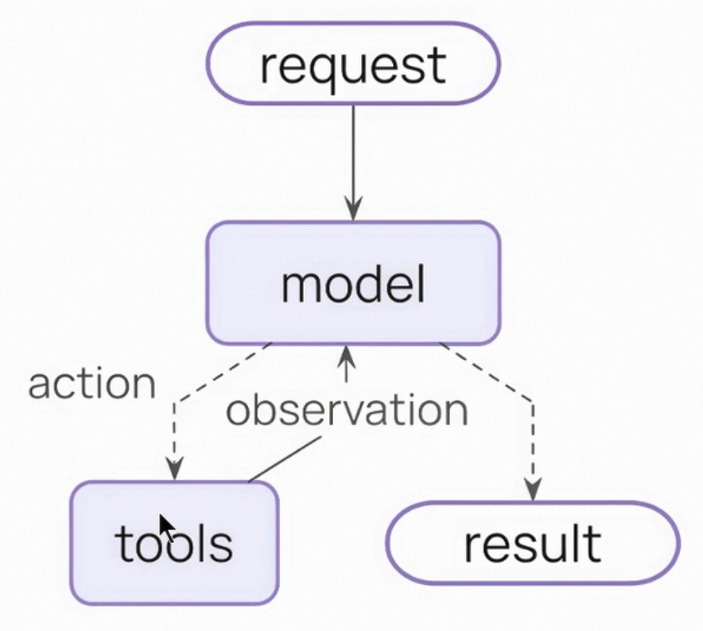

情况2: 添加中间件之后的 Agent 架构:
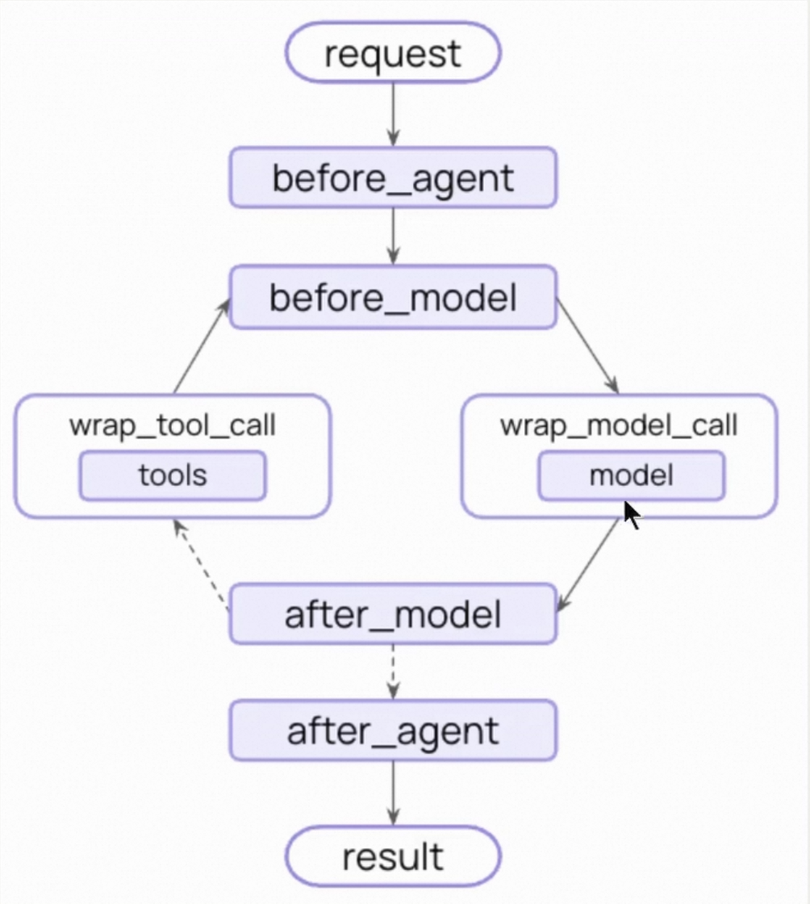

#### 1.2 为什么需要中间件

```python
如果没有中间件, Agent 的执行流程通常比较直接:
用户输入 -> 拼接提示词/消息 -> 调用模型 -> 如有需要调用工具 -> 返回结果
这种方式对于简单场景已经足够, 但一旦进入真实项目, 往往会遇到很多额外需求, 如:
1. 想根据问题复杂度动态 "切换模型"
2. 想 "限制" 某些用户只能调用部分工具
3. 想在工具报错时 "自动重试" 或返回兜底结果
4. 想在模型调用前 "插入额外的系统提示"
5. 想记录每一步的 "执行日志", 方便排查问题
6. 想在敏感信息出现时 "阻断执行"
7. 想在正式执行工具前增加 "人工审批"
这些需求有一个共同特点: 他们不是 Agent 的核心业务逻辑, 但又会影响 Agent 的执行过程. 如果把这些逻辑全部执行写进主流程, 会带来几个问题:
1. 主流程会迅速变乱
Agent 本身只需要关心 "理解用户需求, 决定是否调用工具, 生成结果", 但一旦把日志, 鉴权, 重试, 风控, 审计都塞进去, 侏罗纪就会变得臃肿
2. 很多逻辑是横切需求, 难以复用
例如日志, 重试, 风控, 权限控制, 通常不是某一个 Agent 独有的, 而是多个 Agent 都需要, 如果直接写死在每个 Agent 里, 会产生大量重复代码
3. 流程控制粒度不够细
有些逻辑必须发生在 "模型调用前", 有些要发生在 "工具调用后", 如果没有统一的执行拦截点, 开发者只能手动改主流程, 既麻烦又容易出错
4. 后期维护成本高
当你需要增加一个新规则, 例如: "所有外部工具调用前都先做审计", 如果系统没有中间件机制, 往往需要修改很多处代码
总结:
中间件的价值就在于 "把这些与业务无关, 但与执行过程强相关的横切逻辑, 从 Agent 主流程中分离出来". 让 Agent 主题代码 "聚焦业务", 而借助中间件, 实现 "拦截流程, 修改流程, 增强流程"
简而言之, LangChain 1.x 的中间件能实现如下功能
1. 日志与分析 - 追踪行为, 调试, 性能监控
2. 转换 - 修改提示词, 工具选择, 输出格式
3. 容错 - 重试, 降级, 早期终止
4. 安全 - 限流, 守护规则, PII 检测
```

#### 1.3 中间件的分类

```python
根据 LangChain 是否已经定义了来分类:
自定义中间件: 允许开发者自定义, 从而实现更加灵活的 Agent 行为管理
内置中间件: LangChain 实现并提供的
1. 模型供应商定制的中间件: 依赖于特定模型服务的实现
2. 和模型供应商无关的中间件: LangChain 提供的与供应商无关的中间件如下:
链接: https://docs.langchain.com/oss/python/langchain/middleware/overview
```

#### 1.4 和模型供应商无关的内置中间件分类

```python
LangChain 提供的 和模型供应商无关 的内置中间件分为六个类别
类型1: 成本与资源控制类
核心目标: 控成本, 控配额, 避免无限调用
这类中间件主要解决 "Agent 太贵, 太能跑, 停不下来" 的问题
包含:
1. Model call limit: 限制模型调用次数, 防止一次任务反复请求 LLM, 导致费用失控
2. Tool call limit: 限制工具调用次数, 避免 Agent 无限试错, 死循环调用工具
3. Summarization: 在上下文快满时自动总结历史, 减少 token 消耗
4. Context editing: 裁剪上下文, 清理工具调用痕迹, 本质上也是为了节省上下文成本
业务场景理解:
适合生产环境的成本治理, 配额治理, 长会话优化, SaaS 产品控费

类型2: 稳定性与容错保障类
核心目标: 保证服务不中断, 失败后尽量自动恢复
这类中间件主要解决 "调用失败怎么办, 模型挂了怎么办, 工具超时怎么办"
包含:
1. Model fallback: 主模型失败时切换备用模型
2. Model retry: 模型调用失败后自动重试
3. Tool retry: 工具调用失败后自动重试
业务场景理解:
适合线上生产系统, 尤其是多模型, 多工具依赖的 Agent
本质上是在做 高可用, 容灾, 鲁棒性建设

类型3: 安全与合规风险类
核心目标: 让 Agent 可控, 可审, 合规
这类中间件主要解决 "Agent 乱执行, 泄露敏感信息, 做危险操作" 的问题
包含:
1. Human-in-the-loop: 在关键工具调用前暂停, 等人工审批
2. PII detection: 检测和处理个人敏感信息
3. Model call limit/Tool call limit: 某种意义上也可归到风控, 因为他能防止异常滥用
业务场景理解:
适合企业内部系统, 客服系统, 审批流, 数据查询类 Agent
尤其是涉及: 发邮件, 调数据库, 调财务/人事系统, 导出敏感信息, 执行外部动作等

类型4: 决策增强与智能编排类
核心目标: 提升 Agent 的决策质量和任务拆解能力
这类中间件主要解决 "Agent 不够聪明, 不会规划, 不会先晒工具" 的问题
包含:
1. To-do-list: 给 Agent 增加任务规划, 分步骤执行和状态跟踪能力
2. LLM tool selector: 当工具太多时, 用子模型筛选最吸纳骨干的几个工具交给主模型
3. Subagent: 允许生成子 Agent, 把复杂任务拆给不同角色处理
业务场景理解:
适合复杂任务流, 比如: 研究型 Agent, 多步骤分析, 报告生成, 多角色协作, 长链路任务编排等
这类本质上是在增强 Agent 的 "脑子" 与 "组织能力"

类型5: 执行能力扩展类
核心目标: 给 Agent 更多 "手脚"
这类中间件主要解决 "Agent 只能聊天, 不能真正操作环境" 的问题
包含:
Shell tool: 给 Agent 持久 shell, 会执行命令
File search: 给 Agent 文件搜索能力, 能做 Glob/Grep
Filesystem: 给 Agent 文件系统读写与长期存储能力
业务场景理解:
适合工程 Agent, 代码 Agent, 本地自动化 Agent, 运维 Agent
本质上是把 Agent 从 "纯推理" 扩展成 "能操作环境的执行体"

类型6: 开发调试与测试辅助类
核心目标: 方便开发, 测试, 验证 Agent 行为
这类中间件主要不是直接服务业务, 而是服务于 研发和调试阶段
包含:
LLM tool emulator: 用 LLM 模拟工具执行, 便于测试(最典型)
Summarization: 有时也可以辅助调试长会话表现
Context editing: 可用于测试上下文裁剪效果
Human-in-the-loop: 也常用于调试高风险步骤
业务场景理解:
适合开发阶段快速验证流程, 做 mock, 减少真实工具依赖
```

### 2. 常用内置中间件的使用

```python
LangChain 1.0 提供了 16 个预制中间件, 开箱即用
这里将模型供应商无关的内置中间件分成两部分: 常用内置中间件, 其他内置中间件
```

#### 2.1 SummarizationMiddleware 中间件

```python
作用: 对历史消息列表进行 摘要&总结, 达到压缩上下文的效果
原理: 在达到触发条件时, 调用大模型对历史消息进行摘要, 将摘要的结果作为 HumanMessage, 放到消息列表最开始的位置

参数说明: 
参数1: model -> 用于摘要的模型
可以是模型名称也可以是模型对象, 如果传递的是模型名称, 底层会调用 init_chat_model 初始化模型

参数2: trigger -> 摘要触发条件
是一个列表, 每个元素对应一个条件, 当任一条件满足时, 触发摘要
1. tokens: token 的数量, 历史 token 的累计数量达到该值触发摘要
2. messages: 历史消息数量, 历史消息条数达到该值触发摘要
3. fraction: 上下文长度比例. 历史 token 的累计数量达到模型的 max_input_tokens * fraction 触发摘要
如果条件包含 fractio, 要求模型的 profile 包含 max_input_tokens, Deepseek 模型的 profile 为空, 此时需要手动添加该配置项, Deepseek-v3.2 的长度为 128 k

参数3: keep -> 摘要时保留的原始消息
支持三种条件, 但和 trigger 不同, keep 同一时间只接受一种条件
1. tokens: 摘要时保留的 token 数量
2. messages: 摘要时保留的历史消息条数
3. fraction: 摘要时保留 max_input_tokens * fraction 个 token

参数4: token_counter -> 统计 token 数量的函数
默认使用 LangChain 提供的 count_tokens_approximately, 一般不用更改.
对于纯文本消息, 该函数的大致思路是先统计消息的字符数, 也就是 len(字符串), 然后再除以每个 token 大致的字符数, 转换为粗略的 token 数, 再加上一些额外开销. 作为估算的 token 数.

参数5: summary_prompt -> 摘要时的自定义提示词
该提示词需要包含 {messages} 占位符, 使得历史消息列表可以被插入, 不指定则使用内置提示词

参数6: trim_token_to_summarize -> 摘要时历史消息的最大 token 数
如果历史消息 token 数大于该值, 则会被裁剪. 默认为 "4000".
如果 trigger 用 token 作为度量, 调大触发阈值时, 当前配置项应相应调整, 否则会丢失信息.


```


